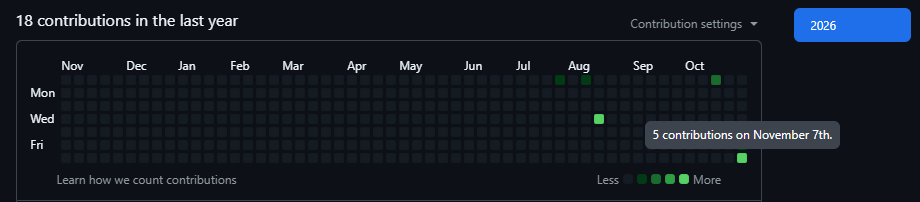

# Welcome to  LeLe14 ! ✨

I am a beginner developer in **Python, C#, and Java**. 💻

I joined the platform in **August 2026**. Right now I have **7 repositories**: 5 public and 2 private. 📋

## 📍 My projects

I'm currently working on a bunch of different little projects! 👻

### | WorldFarm 🌽|

WorldFarm is a french Minecraft server available in 26.2. 🇫🇷

You have to build the best city possible!

Discord: https://discord.gg/tcRSpnqVha

### | PvP Lite ⚔️ |

Pvp Lite is a Minecraft server available in 1.21.11.

You will find different game modes there like PvP or a game mode 100% invented by us, "Fortress".

_The server doesn't have a Discord server._

### | Nookup 🗨️|

Noocup is a social network developed by **karma**. My role is to create and update the app's documentation.

Discord: https://discord.gg/C5PeWQ4hFU

## 📊 My activity curve

You can see my GitHub activity in my public and private repositories. 

Since **November 5, 2026**, I have been trying to actively participate on GitHub.

Have a good day/night of coding! 🚀